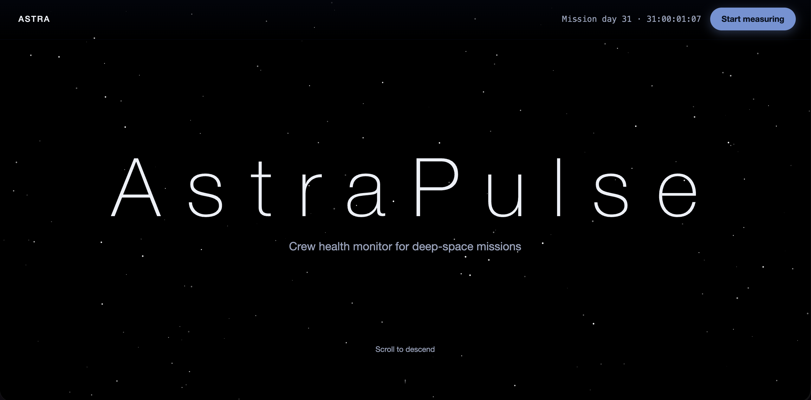
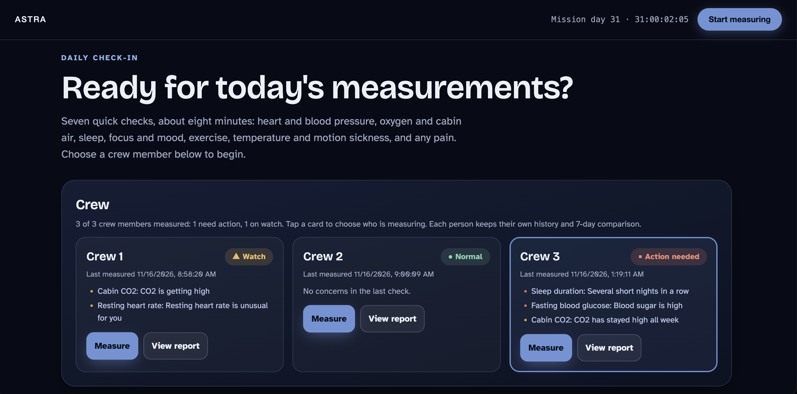

# ASTRA PULSE





ASTRA PULSE is an astronaut health-monitoring system that evaluates crew health indicators using rule-based monitoring and compound health rules.

## Getting Started

Install the required dependencies:

```bash
pip install -r requirements.txt
```

Start the backend:

```bash
python astra_backend.py serve
```

Open the application at:

**http://127.0.0.1:8000/ui/**

## Dataset and Indicators

This version uses rules, containing 20 indicators:

- 16 crew indicators
- 1 motion sickness indicator
- 3 body temperature indicators
- 6 compound rules

The dataset contains 30 days of readings for each crew member:

- `A01_30_days.csv`
- `A02_30_days.csv`
- `A03_30_days.csv`

Each CSV contains 20 indicators plus `posture`. The columns are named after the rule indicator IDs and load automatically.

The database (`astra.db`) is already populated. To reload the data, run:

```bash
python astra_backend.py load A01_30_days.csv --reset
python astra_backend.py load A02_30_days.csv
python astra_backend.py load A03_30_days.csv
```

Each crew member has 600 readings.

## Frontend

The frontend is located at:

```text
astra-frontend/index.html
```

The questionnaire has 7 steps covering the 20 rule indicators, plus an app-only pain question. Body areas on the map follow the indicators: Mind and cabin air, Heart and breathing, Temperature, Motion sickness and Exercise.

Available crew IDs are `A01`, `A02`, and `A03`.

**Dashboard.** Tapping a crew card shows that astronaut's own saved data (latest saved day, scores, last 7 days, sleep and fatigue chart).

**Mission day and phase are dynamic.** The next check is the day after the astronaut's last saved day, in the same phase as that day. The phase can be changed on the measurement screen (for example from inflight to postflight). `?day=&phase=` in the URL still overrides both.

**"Not scored yet".** Personal-baseline checks need 3 earlier days in the same phase and posture. Right after a phase change, readings show "Not scored yet" and the dashboard explains why. Fixed NASA limits still apply during that time.

## Compound Rules

Compound rules can use readings from another group for the same crew member and day.

For example:
- CO2 is in `body_temperature`.
- Headache is in `crew`.
- Heat strain uses crew aerobic minutes.

However, baselines and reference values are never pooled across groups.

